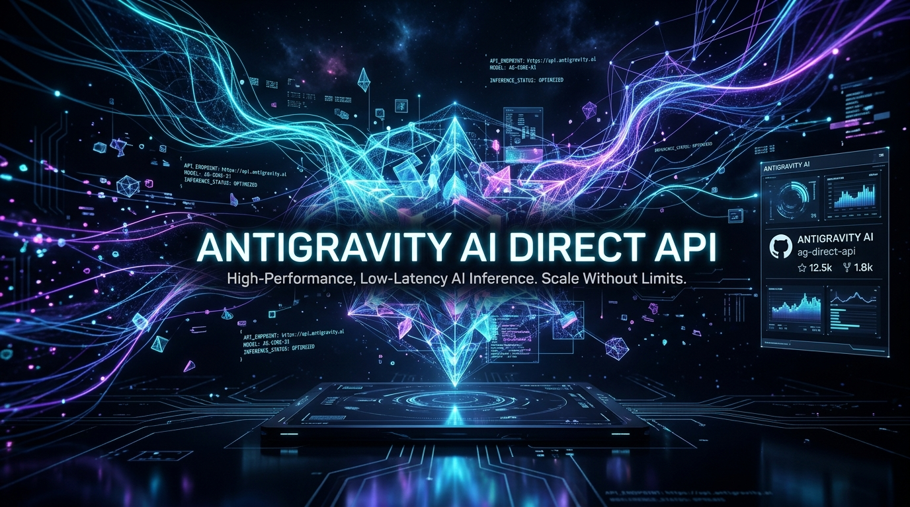
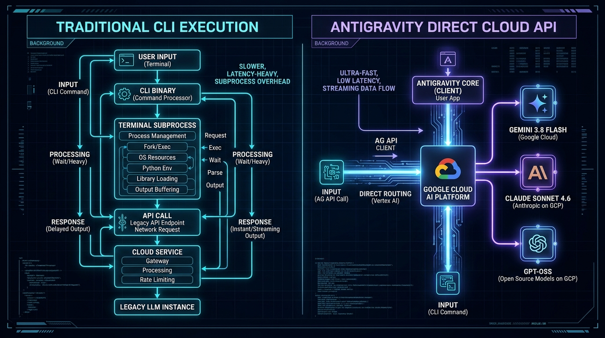
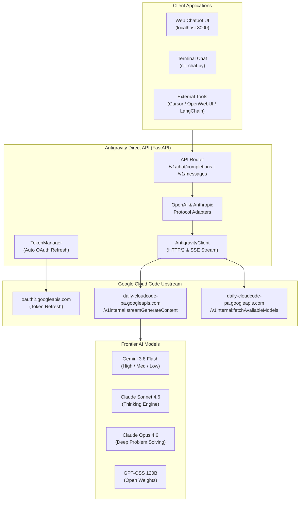

<div align="center">



# ⚡ Antigravity Direct API & Chatbot

> **CLI-Free, High-Performance Direct Cloud Inference Engine for Google Antigravity Models**  
> Direct cloud integration powering **Gemini 3.8 Flash (High / Medium / Low)**, **Claude Sonnet 4.6 (Thinking)**, **Claude Opus 4.6**, **Gemini 3 Flash**, and **GPT-OSS 120B**.  
> **100% Drop-In Compatible with OpenAI & Anthropic SDKs.**

[](https://github.com/vikrant-project/antigravity-api)
[](https://python.org)
[](https://fastapi.tiangolo.com)
[](https://docker.com)
[](https://platform.openai.com/docs)
[](https://anthropic.com)
[](LICENSE)

[Features](#-key-features) • [Architecture](#-architecture) • [Models](#-supported-models--reasoning-tiers) • [Comparison](#-feature-comparison) • [Installation](#-installation--setup) • [API Usage](#-api-usage--integrations) • [Web Chatbot](#-glassmorphic-web-chatbot)

</div>

---

## 🚀 Overview

**Antigravity Direct API** is a lightweight, cloud-native inference bridge created by reverse engineering Google's official Antigravity CLI (`agy`). Instead of running a 220MB Go binary as a terminal subprocess with process management overhead and latency delays, this project connects **directly to Google's backend cloud endpoints** (`daily-cloudcode-pa.googleapis.com`) using HTTP/2 and Server-Sent Events (SSE).

It includes an automated OAuth token management system, full OpenAI `/v1/chat/completions` and Anthropic `/v1/messages` compatible endpoints, a native Python SDK, an interactive terminal chat, and an ultra-modern glassmorphic Web Chatbot UI.

---

## 💡 Key Features

- **⚡ Zero Subprocess Overhead**: Native Python HTTP/2 stream — no spawning `agy` processes, no terminal allocation locks, no IPC buffering latency.
- **🧠 Full Gemini 3.8 Flash Tier Support**: Native access to `gemini-3.8-flash-high` (8,192 reasoning tokens), `medium` (2,048 tokens), and `low` (512 tokens).
- **🎭 Claude Sonnet 4.6 (Thinking) & Opus**: Full extended thinking reasoning with dynamic token budget adjustments.
- **🔄 Automated 24/7 OAuth Refresh**: Background token manager automatically refreshes access tokens using Google's registered OAuth client ID and secret before expiration.
- **🔌 Drop-In SDK Compatibility**: Point Cursor, Continue.dev, OpenWebUI, LibreChat, Chatbox, LangChain, or AutoGen to `http://localhost:8000/v1`.
- **🌐 Glassmorphic Web UI**: Dark theme dashboard with real-time SSE streaming, Markdown, code syntax highlighting, quota indicators, and persona switches.
- **💻 Cross-Platform**: 1-click execution on **Windows**, **Ubuntu / Debian**, **Arch Linux**, **macOS (Apple Silicon & Intel)**, and **Docker**.

---

## 🏛️ Architecture



### Data Flow Diagram



---

## 🧠 Supported Models & Reasoning Tiers

The Antigravity backend runs frontier models on Google Cloud AI Platform:

| Model Identifier | Provider | Display Name | Thinking Budget | Max Tokens | Best For |
|---|---|---|---|---|---|
| **`gemini-3.8-flash-high`** | Google | Gemini 3.8 Flash (High) | `8,192` tokens | 1,048,576 | Complex multi-step reasoning, deep math, advanced coding |
| **`gemini-3.8-flash-medium`** | Google | Gemini 3.8 Flash (Medium) | `2,048` tokens | 1,048,576 | Balanced coding, general assistance, refactoring |
| **`gemini-3.8-flash-low`** | Google | Gemini 3.8 Flash (Low) | `512` tokens | 1,048,576 | Ultra-fast responses, chat, quick summarization |
| **`claude-sonnet-4-6`** | Anthropic | Claude Sonnet 4.6 (Thinking) | `4,096` tokens | 200,000 | System architecture, security audits, code writing |
| **`claude-opus-4-6-thinking`** | Anthropic | Claude Opus 4.6 (Thinking) | `4,096` tokens | 200,000 | Highly nuanced analysis, advanced algorithmic logic |
| **`gemini-3-flash`** | Google | Gemini 3 Flash | None | 1,048,576 | High-throughput tasks, fast extraction |
| **`gemini-2.5-flash`** | Google | Gemini 3.5 Flash Lite | `1,024` tokens | 1,048,576 | Long-context document QA, audio/vision tasks |
| **`gpt-oss-120b-medium`** | OpenAI / OSS | GPT-OSS 120B (Medium) | None | 128,000 | Open-weights frontier coding and instructions |

> **Under the Hood**: Google Cloud registers Gemini 3.8 Flash as `gemini-3.8-flash-tiered`. Our API automatically manages thinking budgets and output sizing rules (`maxOutputTokens > thinkingBudget`) transparently.

---

## 📊 Feature Comparison

| Feature / Metric | Traditional Antigravity CLI (`agy`) | Antigravity Direct API | Official Paid API | Local Ollama |
|---|:---:|:---:|:---:|:---:|
| **Inference Overhead** | ~1.5s - 3s (Subprocess spawn) | **< 150ms (Direct Stream)** | < 200ms | < 100ms |
| **Memory Footprint** | ~350 MB per process | **~35 MB (Single Async Daemon)** | N/A | 16 GB - 64 GB RAM |
| **OpenAI Drop-in (`/v1`)** | ❌ No | **✅ Native Compatibility** | ✅ Yes | ✅ Yes |
| **Anthropic Drop-in (`/v1`)** | ❌ No | **✅ Native Compatibility** | ✅ Yes | ❌ No |
| **Extended Thinking** | CLI Only | **✅ Full Tier Control (High/Med/Low)** | Requires specific headers | Limited |
| **Web UI Dashboard** | ❌ None | **✅ Glassmorphic Dark UI** | ❌ API Only | ❌ Extra Tool Needed |
| **Cloud Deployment** | ❌ Heavy Linux binary required | **✅ Docker, Alpine, VPS Ready** | ✅ Cloud Hosted | ❌ GPU VPS Needed |

---

## 💻 Installation & Setup

### Prerequisites
- Python 3.10 or higher
- An active Antigravity account (logged in via WSL/Linux `agy` or with OAuth token in `.env`)

---

### 1. Windows (10 / 11)

#### Quick Run:
Double-click **`start.bat`** or run via PowerShell:

```powershell
# Clone the repository
git clone https://github.com/vikrant-project/antigravity-api.git
cd antigravity-api

# Install dependencies
python -m pip install -r requirements.txt

# Start Server
python run.py --port 8000
```

---

### 2. Linux (Ubuntu / Debian / Mint)

```bash
# Clone the repository
git clone https://github.com/vikrant-project/antigravity-api.git
cd antigravity-api

# Make start script executable and run
chmod +x start.sh
./start.sh
```

---

### 3. Arch Linux / Manjaro / Fedora

```bash
git clone https://github.com/vikrant-project/antigravity-api.git
cd antigravity-api

# Setup virtual environment
python3 -m venv venv
source venv/bin/activate

# Install requirements & start
pip install -r requirements.txt
python3 run.py --host 0.0.0.0 --port 8000
```

---

### 4. macOS (Apple Silicon M1/M2/M3 & Intel)

```bash
git clone https://github.com/vikrant-project/antigravity-api.git
cd antigravity-api

# Setup Python environment
python3 -m venv venv
source venv/bin/activate
pip install -r requirements.txt

# Run
python3 run.py --port 8000
```

---

### 5. Docker & Cloud VPS (1-Click Deployment)

Deploy instantly on AWS EC2, GCP Compute Engine, DigitalOcean, Hetzner, or Railway:

```bash
# Clone and enter
git clone https://github.com/vikrant-project/antigravity-api.git
cd antigravity-api

# Configure token in .env or pass token.json
cp .env.example .env
# Edit .env with your ANTIGRAVITY_ACCESS_TOKEN and ANTIGRAVITY_REFRESH_TOKEN

# Launch with Docker Compose
docker compose up -d
```

---

## 🔌 API Usage & Integrations

### 1. OpenAI Python SDK

```python
from openai import OpenAI

client = OpenAI(
    base_url="http://localhost:8000/v1",
    api_key="antigravity"  # Any string
)

# Stream response with Gemini 3.8 Flash (High)
stream = client.chat.completions.create(
    model="gemini-3.8-flash-high",
    messages=[
        {"role": "system", "content": "You are an elite software architect."},
        {"role": "user", "content": "Explain WebSocket connection pooling in FastAPI."}
    ],
    stream=True
)

for chunk in stream:
    if chunk.choices[0].delta.content:
        print(chunk.choices[0].delta.content, end="", flush=True)
```

---

### 2. Anthropic Python SDK

```python
import anthropic

client = anthropic.Anthropic(
    base_url="http://localhost:8000",
    api_key="antigravity"
)

message = client.messages.create(
    model="claude-sonnet-4-6",
    max_tokens=4096,
    messages=[{"role": "user", "content": "Conduct a security audit on JWT token handling."}]
)
print(message.content[0].text)
```

---

### 3. Cursor IDE / Continue.dev Integration

- **Model Provider**: `OpenAI`
- **Base URL**: `http://localhost:8000/v1`
- **API Key**: `antigravity`
- **Model Name**: `gemini-3.8-flash-high` or `claude-sonnet-4-6`

---

### 4. cURL (Direct HTTP)

```bash
curl -X POST http://localhost:8000/v1/chat/completions \
  -H "Content-Type: application/json" \
  -d '{
    "model": "gemini-3.8-flash-high",
    "messages": [{"role": "user", "content": "Hello Gemini 3.8 Flash!"}],
    "stream": false
  }'
```

---

### 5. Interactive Python Terminal Chatbot

Want a terminal chat without any web browser? Run our native CLI:

```bash
python cli_chat.py
```

Commands:
- `/model <name>`: Switch models on the fly (e.g. `/model claude-sonnet-4-6`)
- `/models`: List available models
- `/clear`: Clear conversation history
- `/exit`: Exit session

---

## 🎨 Glassmorphic Web Chatbot

Open `http://localhost:8000` in your browser:

- **Model Switcher**: Real-time switching between Gemini 3.8 Flash (High/Med/Low), Claude Sonnet 4.6 Thinking, Claude Opus, and GPT-OSS.
- **System Persona Selector**: Switch between General Assistant, Master Software Engineer, Cybersecurity Auditor, and Cloud Architect.
- **Streaming Response**: Real-time token streaming with syntax-highlighted code blocks and one-click copy.
- **Account & Quota Card**: Live remaining quota bar and connected Google account display.

---

## 🧪 Integration Testing

Run the included automated test suite:

```bash
python test_api.py
```

Test verification covers:
- `test_01_token_discovery_and_refresh`: OAuth auto-refresh verification
- `test_02_gemini_3_8_flash_high`: Gemini 3.8 Flash High tier verification
- `test_03_gemini_3_8_flash_medium`: Gemini 3.8 Flash Medium tier verification
- `test_04_gemini_3_8_flash_low`: Gemini 3.8 Flash Low tier verification
- `test_05_claude_sonnet_4_6`: Claude Sonnet 4.6 Thinking generation
- `test_06_openai_adapter_gemini_3_8`: Standard OpenAI format adapter

---

## 🔬 Reverse Engineering Details

For a detailed technical breakdown of how Google's `agy` binary was decompiled, how the OAuth Client ID and Secret were extracted, and the internal protobuf specifications, read:
👉 **[REVERSE_ENGINEERING.md](REVERSE_ENGINEERING.md)**

---

## 🏷️ Virality, Tags & Keywords

`#antigravity` `#gemini38flash` `#claudesonnet` `#claudeopus` `#reverseengineering` `#fastapi` `#llm` `#aiagent` `#openai` `#anthropic` `#cursor` `#continuedev` `#docker` `#python` `#machinelearning` `#coding` `#cybersecurity` `#devtools` `#opensource` `#cloud`

---

## 📄 License

This project is licensed under the MIT License - see the [LICENSE](LICENSE) file for details.

<div align="center">
  <b>Built with ❤️ by Vikrant Rana (<a href="https://github.com/vikrant-project">@vikrant-project</a>)</b>
</div>
